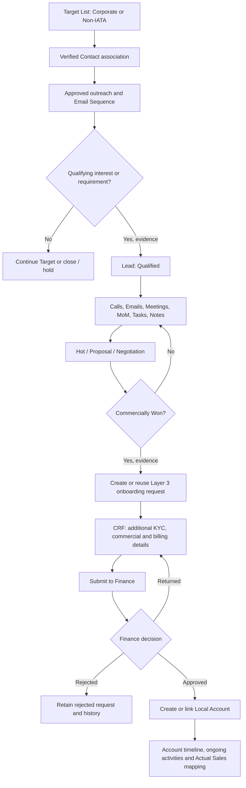

# SAI-CRM Non-Retail Commercial CRM — Version 3.0 Implementation Baseline

> **Implementation alignment (19 November 2026):** This is the approved business baseline originating in PR #75. The active implementation is PR #74, with CRM core database migration 017 and companion release gates in `docs/crm-v3-coordinated-production-release-gates.md`. Stage labels and module semantics in this document express approved business intent; when code differs, treat the mismatch as a development gap, not an implicit approval to change business requirements. Its original Stage 1 status below describes the source branch, not the current PR #74 completion status.

**Business owner direction: 19 November 2026**  
**Delivery status: APPROVED BUSINESS DIRECTION; NOT A PRODUCTION RELEASE**
 
## 0. Purpose and source precedence
Build a connected Corporate and Non-IATA (B2B Agent/Agency) CRM journey on top of the already-developed SAI-CRM administration foundation. Retain existing Business Lines, Countries, Regions, Branches, Departments, Organizational Roles, Reporting Hierarchy, Module Directory and Role Matrix; do not rebuild, duplicate or silently replace their databases. Continue enforcing source-of-truth IDs and permissions.

Sources reviewed: Google Drive `0 New CRM Development` / `# Vercal CRM/CRM_Requirements_V1.md.txt` (lead/account/contact scope); `1. Module & Master/4. Core Modules/Part 2-Leads/Leads.xlsx` (segment-specific and shared fields); `Part 1-Contact/Contacts.xlsx` (contact attributes); `0. Standard/Stanadard Requirement-Working.xlsx` (module registry); `# CRM API/9. CRF/CRF_BI.postman_collection (1).json` (read-only CRF list reference, not an approval contract); `Implementation/MoM/STANDARD SOP 123.docx` (meetings/MoM); `Crm Module Requirements Pack – Template (leads Module Example).docx` (template, NOT approved implementation rules). Existing GitHub `docs/role-matrix-v15.md`, `docs/module-master-v14.md`, `docs/reporting-hierarchy-master-v1.md`, `docs/crm-analytics-y1.md`; Layer 2 approved business decisions BD-02..BD-06 and G-01..G-08 in the project conversations.

When documents differ, the later, explicit business decisions govern the new CRM. Older source lead types (Retail, IATA, Airline, Others) are retained as legacy reference only and are not added to the new non-retail conversion pipeline. Original file terminology is preserved where it differs; for example, **CRF** is the requested Finance approval object, not proof that the legacy CRF_BI API supports new-CRM write/approval operations.

## 1. User-facing business journey

Target stage names: New, Contact Attempted, Contacted, On Hold, Closed / Not Interested.
Lead stage names: Qualified, Hot, Proposal Submitted, Negotiation, Commercially Won, Closed & Dead.
Existing onboarding baseline stage names: Pending, In Progress, Returned for Correction, Approved, Rejected, Cancelled.
CRF is a **distinct Finance review object inside the onboarding workflow**, not a replacement for the approved onboarding stages. Keep commercial win date, CRF submitted/decision date, account-activation date and Actual Sales separately.

## 2. Segments and entity distinctions
- **Corporate**: organizations and eligible subsegments (including SME, NGO/Institution/Government as applicable to business rules), with segment-specific fields derived from source workbook and administrator-controlled taxonomy.
- **Non-IATA**: agents/agencies; B2B channel accounts with agency details and status; never treat Non-IATA as Retail.
- **Global Client**: centrally verified common identity; Parent and Subsidiary are separate records; all suggested matches require Admin review.
- **Target**: pre-qualified prospecting work, can exist while Global Client mapping pending.
- **Lead**: qualified sales opportunity linked to source Target and its evidence; pipeline potential is not revenue.
- **CRF/Onboarding Request**: approval case with additional commercial/finance/KYC information; references the commercially won Lead.
- **Local Account**: approved existing client relationship owned by one Business Line + Branch; separate local naming allowed.
- **FACTS Ledger**: external financial reference; no automatic ledger creation. One ledger may map to one Local Account at a time, with history.
- **Actual Sales**: posted/validated transactions distinct from lead potential, commercial win, and onboarding. Initially use controlled manual uploads, then FACTS integration.
- **Common Contact**: independent person record; may link (with link type and role) to Target, Lead, Global Client and Local Account without duplicating the person.

## 3. Release families and atomic requirements
### 3.1 Existing administration foundation (reuse, do not rebuild)
ADM-001 Preserve canonical Business Line, Country, Region, Branch and Department IDs, lifecycle and dependency controls.
ADM-002 Maintain Organizational Roles separate from permission roles and Employee mapping.
ADM-003 Respect Module Directory eligibility **before** Role Matrix grants; Role Matrix does not yet assign effective user permissions on its own.
ADM-004 Before operational rollout, finish user/employee/branch scope assignment, field/action grants and authenticated cross-branch isolation tests. No new module becomes globally visible by adding a sidebar link.
ADM-005 All new module list views follow Business Lines toolbar, record framework, columns, search/filter/sort, pagination, import/export and lifecycle patterns **only where supported** and without weakening per-module policies.
### 3.2 Target List
TGT-001 Create under one Business Line, Branch, owner and segment; store stable ID, unique source evidence and auditable status.
TGT-002 Support manual creation and reviewed bulk import with server-side duplicate warning, ownership, permissions and validation.
TGT-003 Attach verified Contact(s), organization, optional Global Client match/pending queue and contact preferences.
TGT-004 Record prospecting activities and qualify to Lead only on authorized user action plus logged interest/business requirement evidence.
TGT-005 Conversion creates/reuses a Lead once per qualifying transaction, preserves Target ID and history, and never creates Account.
### 3.3 Email and communication sequencing
SEQ-001 A sequence template contains steps, relative delays, channel, approved content, audience and owner.
SEQ-002 Before scheduling or sending, enforce contact verification, correct purpose/channel/scope consent and centralized suppression rules, active owner and eligible sender identity.
SEQ-003 Central Campaign approval required; BL/Country/Branch may impose stricter approval. Reapprove after material content/audience change.
SEQ-004 Support pause/resume/stop, unsubscribe/bounce/reply handling, deduplication, rate limits, time-zone sending windows and audit.
SEQ-005 Do not silently send real outbound email from Development, Preview, import, or tests. External provider authorization and delivery/opt-out tests are release blockers.
COM-001 Store Calls, Emails, Meetings, MoMs, Tasks and Notes in one activity engine with owner, actor, timestamps, visibility and related-object link(s).
COM-002 Support physical check-in/out with evidence and virtual sessions; meeting type and evidence must not be fabricated.
COM-003 MoM records include agenda, discussion, decisions, opportunities, action items, recipients, share timestamps and SLA result. Use configurable client-type SLA rules; historical MoM document includes inconsistent SLA tables that require explicit configuration before enforcement.
COM-004 Respect cross-branch sharing restrictions; Global Client visibility does not expose another Branch's communications or contacts.
### 3.4 Lead
LED-001 Create Lead from qualified Target or approved direct intake with documented qualification evidence and duplicate controls.
LED-002 Move stages only with authorization and required evidence/reasons, preserving timestamps and old/new values.
LED-003 Commercially Won is Layer 2 terminal outcome and automatically creates or reuses a **linked onboarding request**; no Account or FACTS ledger is automatically created.
LED-004 Closure, reopening and historical migrations have explicit validation and authorized review.
### 3.5 CRF / Finance / Account
CRF-001 Link exactly one active onboarding request / version chain to its winning Lead; protect against duplicate submissions.
CRF-002 Capture additional identity, billing, branch, commercial, payment/credit, tax and documentation details using controlled, segment-aware required fields. Final country-specific KYC/tax requirements are configurable, not hard-coded globally from generic examples.
CRF-003 Finance approvers must be separately assigned and have Approve rights; sales owners cannot self-approve where policy disallows it.
CRF-004 Decision values are Pending, In Review, Returned for Correction, Approved, Rejected, Cancelled; each decision records actor, reason, timestamps, version and history. This is CRF workflow state, not the existing onboarding state list.
CRF-005 On approval, create or reuse an authorized Local Account **in a single idempotent transaction**, with Global Client and ledger mapping guarded separately. Never infer or create external FACTS ledger automatically.
CRF-006 Returned CRF permits correction/resubmission retaining previous version and Finance notes; rejected does not silently become Account.
ACT-001 One Local Account per Business Line + Branch by default; subsidiaries may have independent accounts. Preserve existing account and local legal names.
ACT-002 Show related Contact(s), Leads, target history, activities, CRF, onboarding, ledgers, Actual Sales, financials and change history based on scope.
### 3.6 Contacts and shared timeline
CON-001 A Contact has independent immutable identity; fields come from Contacts.xlsx with per-segment applicability and PII permissions.
CON-002 Association table supports multiple links by entity type, purpose and role; contact deletion/merge must not erase historical activity relations.
CON-003 Verified details have provenance and verification timestamp; AI-enriched information is unverified unless confirmed by approved means.
CON-004 Global Client ID does not automatically grant access to all contacts of another Business Line/Branch.
### 3.7 Analytics
ANL-001 Separate counts: Target prospects, Leads, Commercial Wins, CRF Pending/Returned/Approved/Rejected, Activated Local Accounts, Actual Sales and retention.
ANL-002 KPI drill-down must reconcile to filtered and permission-scoped record IDs; avoid duplicating shared Global Clients across Branch reporting.
ANL-003 Retain Yiron CRM one-way read-only analytics. Verify source completeness and IDs before analytics dashboards or migrations.
ANL-004 Support source lineage, original status and date, published dataset timestamp, excluded/unmapped records and reconciliation queue.

## 4. Proposed dependency-oriented build order
1. Confirm existing main/Production/migrations and permissions; maintain one release register.
2. Implement missing effective User/Employee/Role assignment and server side scope guards (or narrower Super Admin UAT path until complete).
3. Shared identity primitives: Global Client, Target, Common Contact, association/timeline.
4. Target UI/API, reviewed import, qualification evidence and Lead pipeline.
5. Activities/MoM/Tasks/Notes; provider integration for call/email only after security review.
6. CRF, Finance approval roles/queues, idempotent approved Account creation/linkage.
7. Sequence engine and consent/suppression with sandbox delivery first; activate real email only after controlled approval and provider verification.
8. Account and FACTS/Actual Sales, dashboards, data reconciliation.
9. Authenticated acceptance → migration dry run + rollback → production release → live smoke test by role and branch → stakeholder UI review.

## 5. Critical safeguards and open conflicts (technical decisions are not user re-approval requests)
- Legacy Leads/Accounts currently have generic CRM contracts; do not silently upgrade their records or reinterpret legacy `Converted` as Finance-approved Account.
- `server/layer2-stage-policy.mjs` is currently isolated in draft PR #68, not merged; reuse decisions, do not merge as a complete business workflow.
- Draft PR #73 contains an analytics refresh/persistence migration numbered 016. Reserve unique migration numbering before introducing new operational tables; do not run any migration on Production without exact database backup, migration tests and rollback evidence.
- CRF_BI Postman collection shows a list/read endpoint only; it supplies **no verified write API, field requirements or Finance approval contract**.
- Older Leads template includes an immediate Lead-to-Account conversion, inconsistent with the subsequently approved **Commercially Won → Onboarding/CRF → Finance Approval → Account** flow. The later workflow governs new SAI-CRM.
- Older sources have Retail categories and CRM legacy statuses; do not delete source history, merely exclude Retail from this new flow.
- Email connection to Gmail/Workspace or any sender account requires verified provider permissions, bounce/unsubscribe and privacy policy checks; never send real customer mail just to exercise tests.

## 6. Minimum integrated acceptance (release-blocking)
- Test Corporate and Non-IATA from two different Branches (including same-city Branches under separate Business Lines); prevent cross-scope record leakage.
- Unverified/suppressed Contact must not be enrolled or sent a message.
- Approved user can qualify a Target with evidence; duplicate retry does not create a second Lead.
- A Lead can be Commercially Won with recorded evidence, but Account remains absent until Finance approval.
- Unauthorized Finance approval, self-approval (where prohibited), stale versions and concurrent decisions are denied.
- Returned CRF preserves history; Approved CRF creates/reuses exactly one Local Account; rejection creates none.
- Account, Lead, Target and Contact timelines display only permitted linked activities.
- Existing masters, role matrix, current legacy records and Yiron one-way analytics continue to work.
- No production deploy without passing automated CI, isolated PostgreSQL migrations, authenticated browser UAT, recovery validation and verified Vercel Production commit/domain.

## 7. Release register
- **Already merged foundation:** core masters, organizational role, hierarchy, Module Directory and Roles & Permissions (functionality still requires live UAT).
- **Existing operational legacy CRM:** Leads, Customers, Contacts, Opportunities, Activities, Quotations, Bookings; these are not the new non-retail CRF flow.
- **Not yet delivered:** new Target, qualified Lead, CRF Finance approval, Account conversion, contact linking, sequence engine, integrated communications, new reports.
- **This branch:** implementation baseline and isolated, testable domain policy only. No schema, authenticated UI, outbound send or Production changes claimed.
